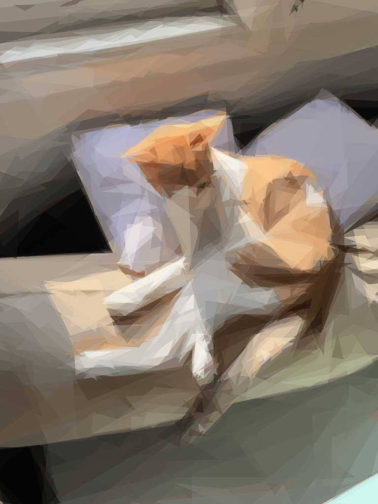
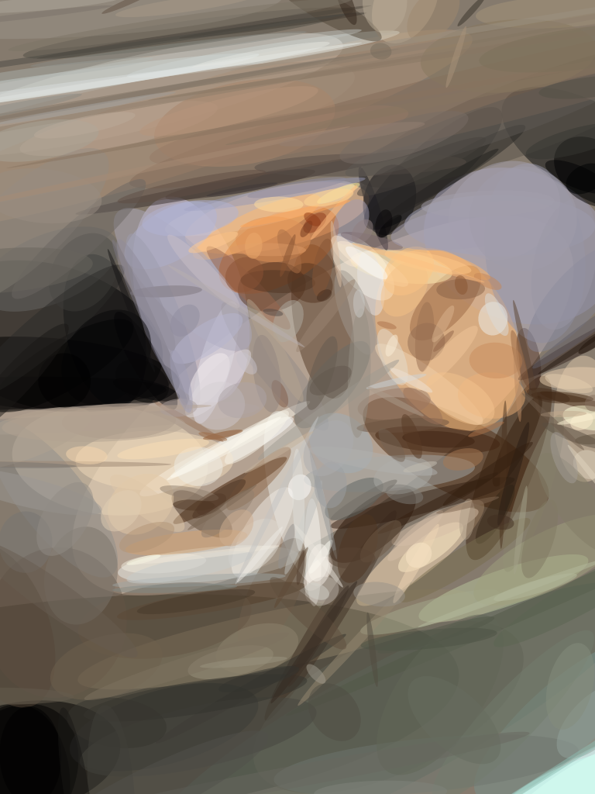
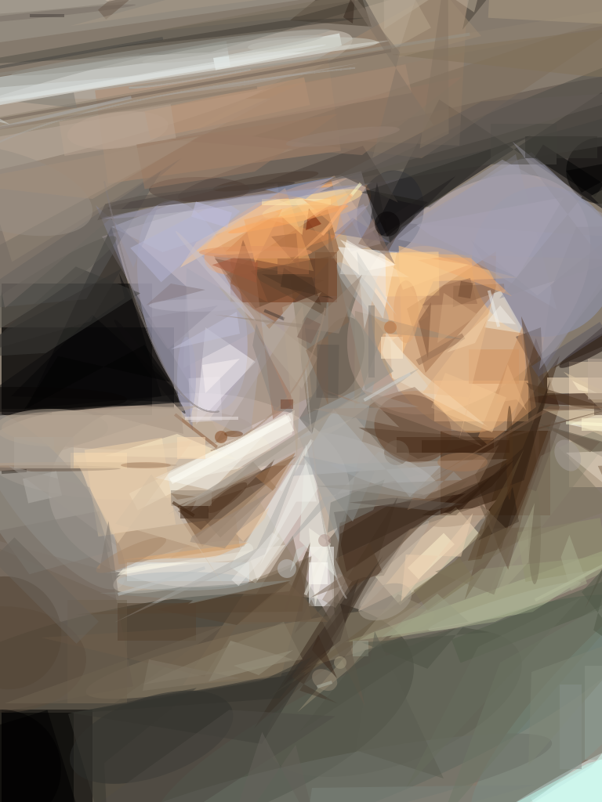

# shapedraw

Reproduce images with geometric primitives, in JavaScript.

shapedraw is a ground-up JavaScript port of Michael Fogleman's
[primitive](https://github.com/fogleman/primitive). It runs as a Node CLI with the same flags as the
original, as a library, and in the browser, with no native dependencies.

**[Try it in your browser →](https://sankshitpandoh.github.io/shapedraw/demo/)**

| 500 triangles | 400 rotated ellipses | 400 mixed shapes |
| --- | --- | --- |
|  |  |  |

## How it works

The goal is to find the one shape that, drawn on top of the current image, brings it closest to the
target, and to repeat that over and over.

1. Start from a canvas filled with the target's average color.
2. Try 1,000 random shapes. For each one, compute the best color for it analytically, then score how
   much the image would improve (root-mean-square pixel error).
3. Hill climb from the best candidate: mutate it (move a vertex, resize, rotate, nudge alpha) and keep
   any change that lowers the error, until 100 mutations in a row fail.
4. Run step 2–3 sixteen times in parallel and keep the overall best shape.
5. Draw it, then go back to step 2.

The search runs at a small working resolution (256px by default) and only rescans the pixels a shape
touches, so it evaluates hundreds of thousands to millions of candidate shapes per second. The final
image is rendered anti-aliased at full output size, or written out as SVG.

## Install

```bash
git clone https://github.com/sankshitpandoh/shapedraw.git
cd shapedraw
npm install
npm link   # optional: puts `shapedraw` on your PATH
```

Requires Node 18 or newer.

## Command line

```bash
shapedraw -i input.jpg -o output.png -n 100
```

| Flag | Default | Description |
| --- | --- | --- |
| `-i` | n/a | input image (PNG or JPEG, `-` for stdin) |
| `-o` | n/a | output path: `.png`, `.jpg`, `.svg` or `.gif`; repeatable; `-` writes SVG to stdout |
| `-n` | n/a | number of shapes |
| `-m` | 1 | mode: 0=combo 1=triangle 2=rect 3=ellipse 4=circle 5=rotatedrect 6=beziers 7=rotatedellipse 8=polygon |
| `-rep` | 0 | add N extra shapes each iteration with a cheaper local search |
| `-nth` | 1 | save every Nth frame (only when `%d` is in the output path) |
| `-r` | 256 | resize large inputs to this size before processing |
| `-s` | 1024 | output image size |
| `-a` | 128 | alpha; `0` lets the algorithm choose per shape |
| `-bg` | average | starting background color (hex) |
| `-j` | all cores | number of worker threads |
| `-seed` | random | random seed, for reproducible output |
| `-v`, `-vv` | off | verbose / very verbose |

Flags are read in order, so you can layer different shape types:

```bash
# 50 rectangles to block in the composition, then 200 triangles of detail
shapedraw -i in.jpg -o out.svg -m 2 -n 50 -m 1 -n 200
```

Write every frame for an animation, or a GIF directly:

```bash
shapedraw -i in.jpg -o frames/%03d.png -n 200
shapedraw -i in.jpg -o out.gif -n 200
```

## Browser

Use the [live demo](https://sankshitpandoh.github.io/shapedraw/demo/), or serve the repository root over HTTP and open `/demo/`:

```bash
npm run demo   # then visit http://localhost:8080/demo/
```

Drop in an image and watch it being drawn. The search runs in Web Workers, one per core, and you can
download the result as SVG or PNG. It needs no build step: the demo imports the library's ES modules
directly.

## Library

```js
import { Model, ShapeType, thumbnail } from 'shapedraw';
import { createNodePool, loadImage, savePNG } from 'shapedraw/node';

const target = thumbnail(loadImage('in.jpg'), 256);
const model = new Model(target, { size: 1024, pool: createNodePool() });

for (let i = 0; i < 200; i++) {
  await model.step(ShapeType.TRIANGLE, 128, 0);
}

savePNG('out.png', model.image());
const svg = model.svg();
const json = model.toJSON(); // shapes, colors and geometry, for your own renderer
model.close();
```

Images are plain `{ width, height, data }` objects with premultiplied RGBA bytes, the same shape as a
browser `ImageData` (call `premultiply()` on canvas data first). In the browser, use
`createWebPool()` from `shapedraw/web`. Without a pool, `Model` searches on the calling thread.

## Differences from the Go version

- **Rasterizer.** The Go version uses `golang/freetype/raster` for polygons, rotated ellipses and
  bezier strokes, and `fogleman/gg` to render the final image. shapedraw has its own small
  anti-aliased scanline rasterizer (`src/raster.js`) that does both jobs.
- **GIF output** is encoded in-process with [gifenc](https://github.com/mattdesl/gifenc) instead of
  shelling out to ImageMagick.
- **Seeds.** `-seed` makes runs reproducible for a given worker count.
- The search algorithm, shape mutations, color computation, scoring and SVG output follow the Go code
  closely, including its integer rounding. Scores track the original within noise:

  | 20 shapes, same input | Go | shapedraw |
  | --- | --- | --- |
  | triangles | 0.0955 | 0.0977 |
  | beziers (15) | 0.1693 | 0.1695 |
  | polygons (15) | 0.0986 | 0.0988 |

Speed on an Apple Silicon laptop (256px working size, triangles): Go evaluates about 1.5M shapes/s
across all cores and shapedraw about 1.0M/s in Node. In the browser demo it reaches about 0.9M/s.

## Tests

```bash
npm test
```

## License

MIT. The original primitive is © 2016 Michael Fogleman. See [LICENSE](LICENSE).
